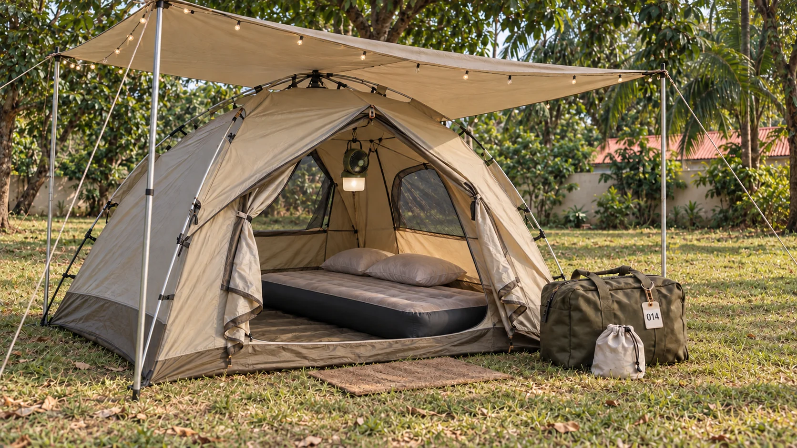
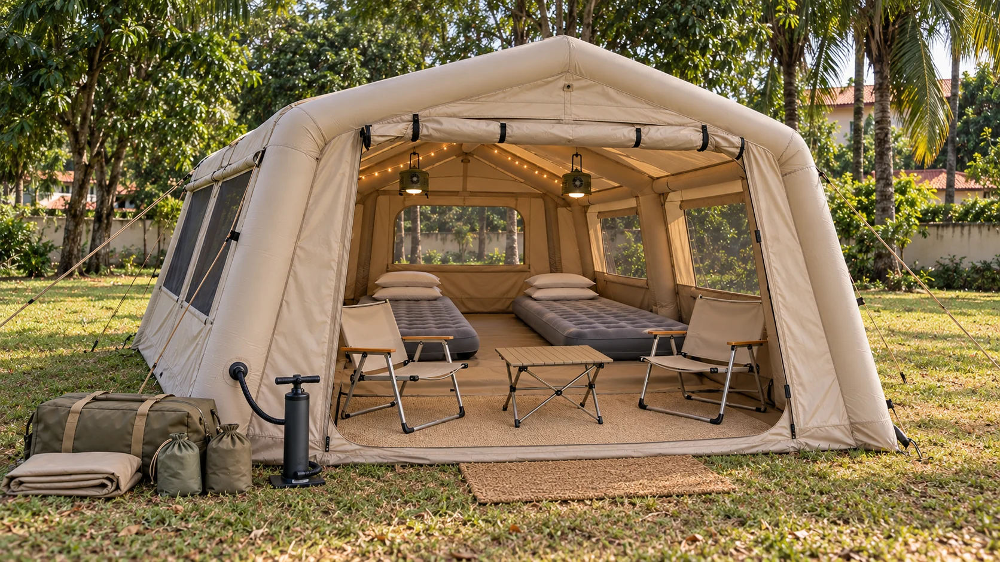
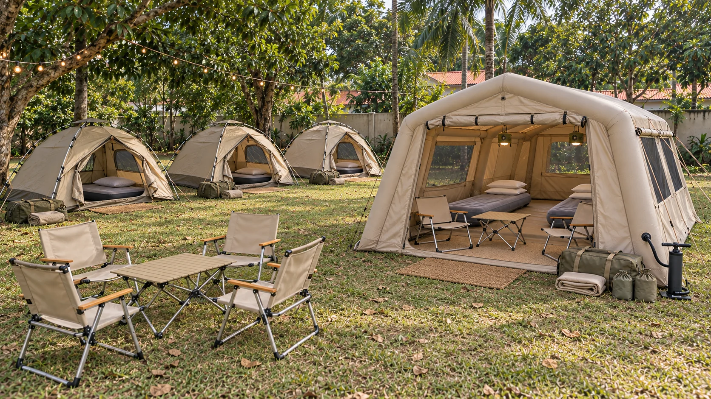

# Rental kits and the Yiwu buy list

25 October 2026 · Draft from the founders' brainstorm during the Yiwu trip (3 days left in market)

> **Read this first.** Prices marked *(est)* are guesses to plan with, not quotes. The main tent's price is still unknown, and every total below moves with it: each ¥50 on the tent changes the recommended buy by about ¥750. Exchange rates assumed: **¥7.15 = $1** and **₦1,550 = $1**. Check both before committing.
>
> The brief for whoever sources on our behalf is a separate document: [2026-10-25-sourcing-brief.md](2026-10-25-sourcing-brief.md).

## What the complete kits could look like

These AI-generated concepts show the intended experience in a Nigerian garden setting inspired by our existing event photography. They are not supplier photographs, confirmed stock or approved samples. The written kit contents and quantities remain the source of truth; dimensions, materials and the final tarp setup still need confirmation.

<figure>

<figcaption><strong>Standard kit.</strong> Automatic aluminium-pole tent, mattress, pillow covers, fan-light, weather protection, doormat, welcome pouch and kit bag. The shared mattress pump is not shown; the tent itself uses poles.</figcaption>
</figure>

<figure>

<figcaption><strong>Luxury kit.</strong> Inflatable air beams with a manual pump connected to the tent valve; two sleeping spaces, two fan-lights, two chairs, a side table and rug. No rigid tent poles. The weather tarp is shown folded while its setup remains open.</figcaption>
</figure>

<figure>

<figcaption><strong>The event experience.</strong> Standard and Luxury kits together, with a separate shared seating area. Outdoor tables and chairs are an event add-on. The scene is an illustrative arrangement, not the recommended order quantities. Upgrade packs reuse the sleep accessories shown in the Standard kit with suitable tents we already own.</figcaption>
</figure>

**18-second concept presentation** — a silent animated presentation of these images, not footage of purchased stock.

<video controls playsinline preload="none" poster="media/event-layout-concept.webp" aria-label="Camping Nigeria kit concept presentation">
<source src="media/kit-overview.webm" type="video/webm">
Your browser cannot play this WebM. The images above show every scene.
</video>

## Why we are doing this

We want to move up the value chain, from renting loose gear to renting a **finished night**. A renter, mostly schools and organisations, books "20 sleep kits" and every guest gets everything they need to sleep well. They don't have to source anything else.

Kits are also easier for us to run. We count, pack, check out and inspect identical kits instead of loose items, and a missing part shows up at check-in ("kit #14 came back without its fan").

For our own events (Camp Night, MAD Settings, future editions) we do the set-up ourselves, so we start from the same kit and add whatever each event needs.

**Success:** every kit is complete and repeatable, guests stop waking up on wet mattresses, every tent smells clean when it's unzipped, and the investment, including shipping and handling, is paid back within **6 months of the kits landing**.

**Failure, even if it technically works:** a pile of tents with no tarps, fans or bedding to make them a kit. *Complete beats many.* 20–25 complete kits are worth more than 50 bare tents.

## Decisions so far

- **The new Standard kit is the luxury version of what we offer today.** It is not a budget tier. Pricing logic, go-to-market and how products appear on the website will all change once the premium stock lands. That is planned after the trip.
- **We buy premium, export-grade products.** Nothing made down to a price for African markets. The sourcing brief says this plainly to suppliers.
- **The solar fan + light combo stays in every kit.** It's one of the most valuable parts. Where to buy it is still open (see *Shipping*).
- **No other battery goods from Yiwu this trip.** The power station gets bought in Nigeria. Pumps must be manual or mains-electric.
- **5 luxury kits, not 3.**
- **The tarp setup is still open.** The founders are working it out. The kits keep ¥60 as a placeholder.

## What the Camp Night debrief told us

From [docs/camp-night/debrief-2026-09-26.md](../camp-night/debrief-2026-09-26.md):

- Mattresses got wet. This was the top fix: a tarp under each tent, a tarp over the top, and thicker tents.
- Guests want thin, quick, stackable inflatable mattresses, plus lights and small fans they can hang inside.
- Tables and chairs should be a paid add-on. Daniel asked for a VIP section.
- Brand every tent, and tag each tent with a number so it can be matched to its sign-up code.
- Drawstring bags help clean-up. A full-time cleaner should own the tents.

Today a guest gets a tent, a mattress and throw pillows. The foam mattresses are **rented from another organisation** and are not premium.

## What we already have

These counts come from the quote tool's pricing sheet on 25/10/2026. Active damage or write-off adjustments are stored in the tool's database and were **not** checked, so confirm against the inventory page.

| Item | Owned | Rental price |
|---|---|---|
| 1-person tent | 20 | ₦10,000 |
| 2-person tent | 20 | ₦16,000 |
| 4-person tent | 5 | ₦21,000 |
| 6-person tent | 4 | ₦30,000 |
| 8-person tent | **not in the sheet** | — |
| Camping chairs | 50 | ₦3,000 |
| Camping tables | 25 | ₦3,000 |
| Canopies | 13 | ₦20,000 |
| Camping lights | 30 | ₦2,000 |
| Pillows | 67 | ₦1,000 |
| Mattresses | listed as 340 | ₦3,000 |

Two fixes are needed in the sheet:
1. The **8-person tent** has a volume-break row (₦30,000 at 10+) but no item row, so the tool can't quote it.
2. The **mattresses are rented**, not owned. Listing 340 as owned overstates what we can promise.

## The products

### Standard kit: our volume product

One per tent. Self-collect, or delivered and set up for large jobs.

| Item | ¥ per kit | Source |
|---|---|---|
| Automatic tent, aluminium poles | ~250 | **(est, not priced yet)** |
| Ground tarp + fly tarp | ~60 | (est; tarp setup still open) |
| Inflatable mattress / cot | 65 | priced |
| Solar fan + light combo | 26 | priced (¥624 per carton of 24) |
| 2 washable pillow covers | ~10 | (est) |
| Kit bag + numbered ID tag / logo patch | ~20 | (est) |
| Doormat for the tent door | ~5 | (est) |
| String lights (USB or AA, no built-in battery) | ~10 | (est) |
| Drawstring welcome pouch | ~3 | (est) |
| Share of a manual / mains pump (1 per 5 kits) | ~8 | (est) |
| **Total** | **~¥460 ≈ $64** | about $97 landed |

The pillows themselves come from our existing stock, or as a take-home item. Our sourcing rule is that pillows are sold, not rented. We rent the washable cover and launder it.

The welcome pouch is bought in Yiwu and filled in Nigeria before each rental: mosquito repellent, water, and a scent card. The same bag also works as the clean-up bag the debrief asked for.

### Luxury kit: the new experience, and the VIP answer

| Item | ¥ per kit | Source |
|---|---|---|
| Large inflatable tent | ~420 | priced ¥360–480 (a second find was ¥750) |
| Ground tarp + fly tarp | ~60 | (est; tarp setup still open) |
| 2 inflatable mattresses / cots | 130 | priced |
| 2 solar fan + light combos | 52 | priced |
| 2 chairs | 66 | priced |
| Side table | ~40 | (est) |
| Inside rug | ~40 | (est) |
| Doormat, string lights, 2 pouches, 4 pillow covers | ~41 | (est) |
| Kit bag + ID tag | ~20 | (est) |
| Share of a manual / mains pump for the tent | ~20 | (est, unless one is included) |
| **Total** | **~¥890 ≈ $124** | about $187 landed |

### Upgrade pack: makes our newer tents premium

This is the Standard kit without the tent, for the newer tents we already own and that are worth keeping. **About ¥207 ≈ $29 per pack**, plus one more mattress for each extra sleeper:

- **4-person tent:** 1 extra mattress → ~¥272
- **6-person tent:** 2 extra mattresses → ~¥337

The plan assumes 10 packs: our 5 four-person tents, our 4 six-person tents and 1 two-person tent, if they're all in good shape. Count the tents that are genuinely worth upgrading before buying.

### Add-ons, priced per event (not per tent)

- **Seating pack**, priced **per guest**: from our 50 chairs and 25 tables. Chairs cost ¥33 in Yiwu if we need more.
- **Outdoor cinema**: projector, inflatable screen, speaker.
- **Power**: a solar power station (about 1,000 Wh) plus a folding panel. One per site, not per kit, to run the projector, the shared lights and a phone-charging point. **Bought in Nigeria.** Generators stay as backup for large jobs.
- **Fire pit or grill**, and **lawn games** (giant Jenga, cornhole).

### Tables and chairs: the rule

Sleep gear is priced **per tent**. Shared seating is priced **per guest**, as an add-on. The only exception is the luxury kit, which comes with a table and two chairs inside the tent.

## Sourcing tiers

| Tier | Meaning | Items |
|---|---|---|
| **1: must have** | Without it, a kit is not complete | Aluminium automatic tent, tarps, inflatable mattress, solar fan + light combo, pillow covers, kit bag + ID tag, manual / mains pumps, doormat, string lights, welcome pouch. **Per site:** first aid kit, spares (pumps, pegs, poles, hubs) |
| **2: premium** | Turns a kit into the luxury experience | Inflatable tents, inside rugs, side tables, chairs |
| **3: experiences** | Buy only if Tiers 1–2 come in under budget | Projector + screen, fire pit / grill, lawn games, aluminium hiking sticks (¥9, good for school hikes), life jackets (still to price) |
| **Not this trip** | | Battery goods other than the fan + light combo (rechargeable pumps, power stations); suitcases (¥480; not core); the ¥145 two-person tent (its **fibreglass poles break our no-fibreglass-on-rental rule**); backpacks (better as merch later) |

## The buy: three options

All totals assume the fan + light combos come from Yiwu: 2 cartons of 24, at a guessed ×1.6 landed for the battery line. They also include about ¥240 of per-site and spare items: 2 first aid kits, 2 spare pumps, spare pegs, poles and tent hubs.

| Option | What it buys | Goods | Landed |
|---|---|---|---|
| **A. More new tents** | 20 standard + 5 luxury = 25 kits | ~¥14,350 | **~$3,030** |
| **B. Recommended** | 15 standard + 5 luxury + 10 upgrade packs = 30 kits | ~¥14,850 | **~$3,130** |
| **C. Tents only** | 15 standard + 10 upgrade packs = 25 kits, no luxury | ~¥10,650 | **~$2,250** |

**Why B:** for about $100 more than A, it gives 5 more complete kits, and it lifts the price of tents we already own (see *Pricing*). It is about $130 over the $3,000 ceiling. Two ways to bring it back:

- 14 standard kits instead of 15 (saves about $100);
- buy the fan + light combos in Nigeria, if the local price beats the battery-line cost.

If the main tent comes in well under ¥250, the savings bring B under the ceiling by themselves.

## Shipping and landed cost

The ×1.5 multiplier (shipping, clearing, duty, handling on top of Yiwu prices) is a **planning guess**. Replace it with a real quote from a Yiwu–Nigeria cargo agent. Ask them:

1. The door-to-door rate per CBM to Abuja (or Lagos plus onward transport), and what it includes: duty, clearing, delivery.
2. Transit time. Sea freight takes about 45–60 days, so kits land around **January 2027**. The 6-month payback clock starts then, giving us roughly 3 dry-season months before the rains.
3. Whether they consolidate goods from several Yiwu suppliers at their warehouse, and whether they photograph the goods on arrival.

**Fan + light combos and batteries.** The ¥26 solar fan + light combo charges a built-in lithium battery, so it counts as battery goods. Ask the agent:

- whether they carry battery goods at all, and at what rate;
- whether the combos can travel as a separate small battery-line consignment, so the rest of the order ships at the normal rate.

If the rate is unreasonable, buy the combos in Nigeria.

For everything else, **check with each supplier that nothing comes with a lithium battery inside.** String lights, pumps and inflatable tents sometimes include one, and a single battery item can push a shipment onto the pricier battery line.

Inflatable tents are heavy and bulky. Get the packed size and weight from the supplier so the CBM estimate is real.

## Pricing

### What people already pay

| Anchor | Price |
|---|---|
| Our Camp Night tent packages (Sept 2026, whole night incl. event) | ₦20,000–₦30,000 |
| Our MAD Settings sleepover tickets (Oct 2026, whole night incl. event) | ₦30,000 single, ₦35,000 couple |
| Lagos overnight beach camping (public listing) | from ₦20,000 |
| Lufasi Lodges geo-dome glamping, Lagos (Oct 2026, Mon–Thu, before tax) | ₦255,000 single, ₦410,000 two sharing |
| Today's comparable kit, bought from us à la carte | ~₦23,000 (2-person tent + mattress + 2 pillows + light) |

### Draft prices

| Product | List price per rental | Why |
|---|---|---|
| **Standard kit** | **₦40,000** | Volume breaks down to about ₦34,000 at 20+ kits, so the average comes out around ₦38,000. |
| **Luxury kit** | **₦100,000** | Sleeps two, so about ₦50,000 a head. Allow ₦85,000–₦95,000 for early or volume clients. |
| **Upgraded 4-person tent** | **₦45,000** | Today it rents for about ₦31,000 à la carte (tent + 2 mattresses, 2 pillows, light). |
| **Upgraded 6-person tent** | **₦60,000** | Today about ₦44,000 à la carte. |
| **Upgraded 2-person tent** | **₦30,000** | Same kit, older and smaller tent. |
| **Set-up by our crew** | existing delivery % plus a set-up fee per kit | Default for schools and organisations. |
| **Add-ons** | per event / per guest | Price once the costs are known. |

**Is ₦100,000 justified for luxury? Yes, if the experience shows it.** That means the tent is set up and styled when the guest arrives: raised beds, fans, rug, string lights, table and chairs, a signature scent, a sealed "cleaned & ready" tag. At about ₦50,000 a head it sits well under Lufasi (₦255,000+ a night) and clearly above basic camping (₦20,000–₦35,000). The luxury tier also makes the ₦40,000 standard kit look reasonable next to it.

**Is ₦35,000 high enough for standard? It's low.** List it at ₦40,000 and let volume breaks bring big orders down. One caution: our own guests pay ₦30,000–₦35,000 for a whole night *including* the event. A renter who resells kits to their own guests needs room for a margin, so schools need per-student pricing with real volume breaks. Corporate clients can pay list price.

**Our own events are now underpriced.** If we put these kits into the next Camp Night or MAD Settings, a ₦30,000–₦35,000 sleepover ticket no longer covers what the guest gets. Sleepover tickets with a standard kit should go up, and the luxury kits become a VIP ticket priced well above ₦100,000.

These are starting points to test, not decisions. Pricing logic and how it's sold get reworked properly after the trip.

### How this improves our financial position

| | Old draft prices (₦35k / ₦30k / ₦85k) | New draft prices |
|---|---|---|
| Revenue from one full deployment of the 30 kits in option B | ₦1.25M | **₦1.54M** |
| Less consumables and cleaning (~₦2,500 per kit, est) | ₦1.175M net | **₦1.465M net** |
| Investment (about $3,130 ≈ ₦4.85M) repaid after | ~4.1 full deployments | **~3.3 full deployments** |
| At about 50% average booking | ~8 events in 6 months | **~7 events in 6 months** |

New revenue is 15 standard × ₦38,000 average + 5 four-person × ₦45,000 + 4 six-person × ₦60,000 + 1 two-person × ₦30,000 + 5 luxury × ₦100,000.

**Across the whole fleet,** one full deployment of everything we own earns about **₦1.1M today** at à la carte prices (49 tents). After option B it earns about **₦2.3M**: 30 kits, plus the 1- and 2-person tents still rented the old way. Most of that gain comes from the new kits and the luxury tier, not from upgrades.

**Upgrading the rest of the fleet, honestly:**
- **4- and 6-person tents: worth it.** Each one earns ₦14,000–₦16,000 more per rental, and every tent we own counts as a complete kit.
- **1- and 2-person tents: weak on the numbers.** A ₦7,000 lift per rental takes about 8–10 rentals to repay a pack. Do it later, out of revenue, once the first kits prove demand. Or keep them as a cheaper "Essentials" line for price-sensitive school bookings, so the range runs Essentials / Standard / Luxury.
- **Owning mattresses stops a cost.** Every rental with an inflatable mattress is one fewer foam mattress we pay another organisation for. We don't know that rental cost yet, but it comes straight off the payback.

## Is 5 luxury kits still worth it?

**Yes, as long as they rent.** Per kit, luxury pays back faster than standard:

| | Landed cost | Price | Rentals to pay back |
|---|---|---|---|
| Standard kit | ~₦150,000 | ₦38,000 average | ~4 |
| Luxury kit | ~₦290,000 | ₦100,000 list | **~3** |

The risk is not the cost. It's that 5 luxury kits tie up about ₦1.45M in the least proven demand. Two things lower that risk:

- **Our own events are a guaranteed first customer.** A VIP row of 5 luxury tents at the next Camp Night or MAD Settings is what Daniel asked for, and it tests the price on our own guests before we offer it to renters.
- **If luxury doesn't rent at ₦100,000,** the inflatable tents still work as premium family tents at a lower price.

## Risk and reward

| Risk | How we limit it |
|---|---|
| Landed cost higher than planned (customs, battery line, FX) | Get the cargo quote **before** ordering. Trim option B to 14 standard kits if needed. |
| Products turn out lower quality than the sample (the "made for Africa" risk) | Approved sample = the standard. Pre-shipment inspection with photos and video before the balance is paid. See the sourcing brief. |
| Inflatable tents fail in Nigerian heat (seams, valves, coatings) | Inspect a pitched sample before ordering all 5. Ask for hydrolysis-resistant coating and a repair kit. |
| Automatic tent hubs break (the usual failure point) | Buy spare hubs. Prefer suppliers who stock them. |
| No renters at the new prices | Our own events use the kits regardless. Imported gear keeps resale value. Prices are tested, not fixed. |
| Kits land late in the dry season | Order this trip. Take sea-freight timing into account when planning first bookings. |

**Verdict:** worth it with 5 luxury kits (option B, about $3,130, or about $3,030 with 14 standard kits). The worst realistic outcome is that the kits only upgrade our own events, which we would want anyway.

## What to check on each sample

The full checklist for whoever sources on our behalf is in the [sourcing brief](2026-10-25-sourcing-brief.md). The short version:

- **Automatic tent.** Poles really aluminium (a magnet won't stick to aluminium, but it will to steel). Fly hydrostatic head ≥ 3,000 mm, floor ≥ 5,000 mm. Seams taped. Two doors and good ventilation. Spare hubs and poles available.
- **Inflatable tent.** Fabric, number of air beams, valve type, the pump that comes with it (no built-in battery), repair kit, packed weight. Pitch one if possible.
- **Inflatable mattress / cot.** Weight rating, PVC thickness, valve, flocked top.
- **Solar fan + light.** Battery capacity, fan run-time on one charge, brightness, hanging hook.

## The next 3 days

1. **Day 1.** Price and size the automatic aluminium tent, and inspect a sample. Get the cargo agent's per-CBM quote and their battery-goods rate for 2 cartons of fan + light combos. Recalculate option B with the real numbers. Hand the sourcing brief to the agent.
2. **Day 2.** Lock in the Tier 1 suppliers and order by full cartons where it lowers the price. Inspect a pitched inflatable tent, then order the 5 luxury tents.
3. **Day 3.** Buy the Tier 2 extras and send everything to the agent's warehouse. Keep a photo and spec sheet of every item bought, for the quote tool and the handbook.

## The smell-and-comfort reset (to detail later)

After every rental: dry the tent completely before packing (damp tents grow mildew and go musty), wipe the floor, launder the covers, spray with one **signature scent**, pack with a sachet, and seal the kit bag with a "cleaned & ready" tag that the renter breaks on arrival. The full-time cleaner from the debrief owns this routine.

## Open questions

1. **What does the automatic aluminium tent cost, and how many people does it sleep?** This blocks every total.
2. Are the 4- and 6-person tents in good enough shape for upgrade packs? Do we own any 8-person tents?
3. What does the cargo agent quote per CBM, and for battery goods?
4. Fan + light combos: Yiwu on the battery line, or Nigeria?
5. What do we pay to rent each foam mattress today?
6. Will renters pay ₦40,000 for standard and ₦100,000 for luxury?
7. Are rentals priced per event or per day? The sheet looks flat per rental.

## Still to plan after the trip

1. **Pricing and go-to-market:** new pricing logic built around the premium kits (Essentials / Standard / Luxury), final kit and add-on prices, own-event ticket prices, adding kits as items in the quote tool's pricing sheet (plus the 8-person tent and mattress fixes), and changing how products are shown on the website's gear-rental page.
2. **Operations:** check-in/check-out against tent ID tags, the reset routine, set-up crews, damage handling.
3. **Luxury positioning and marketing:** naming, photography, and how the experience is sold.
